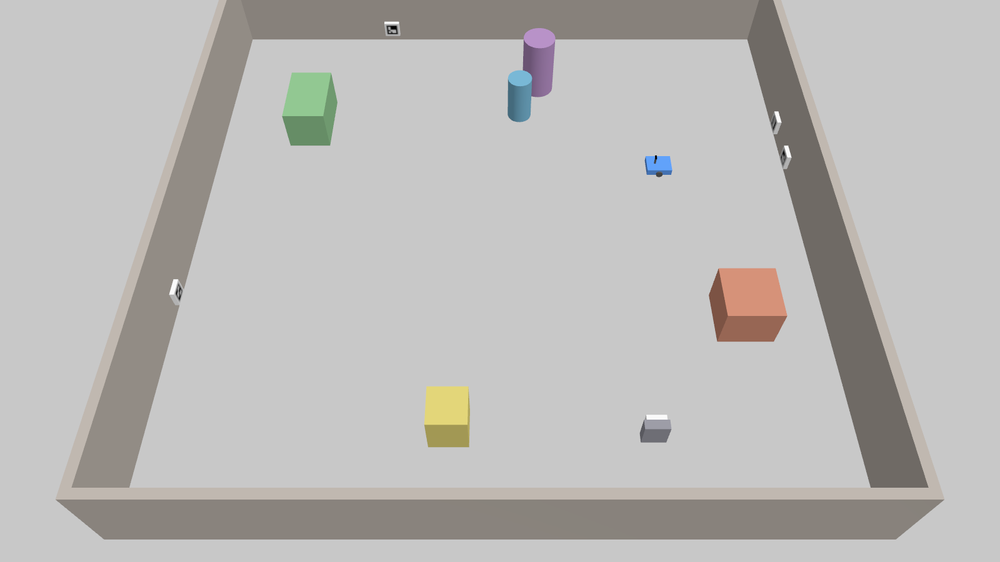
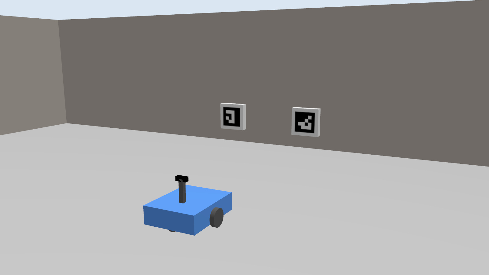
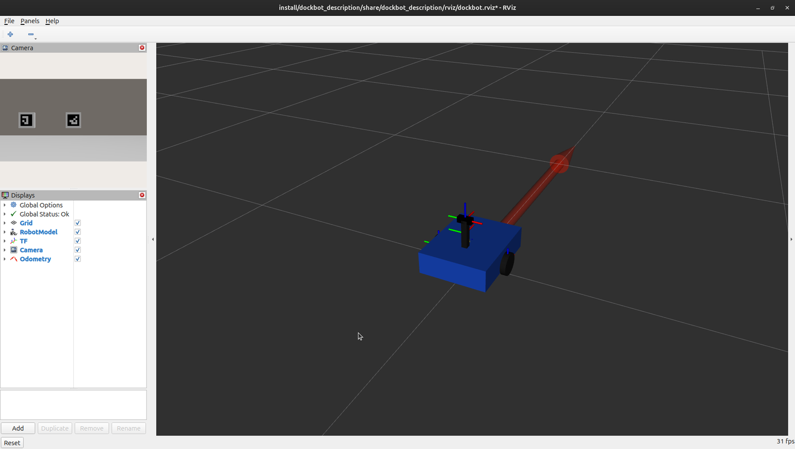
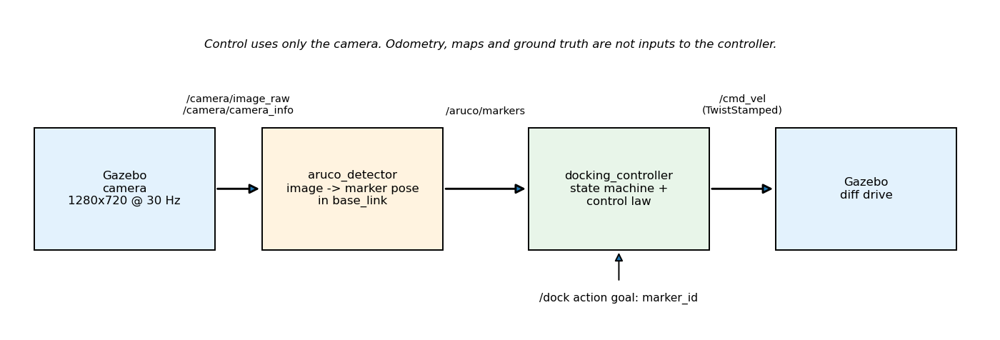
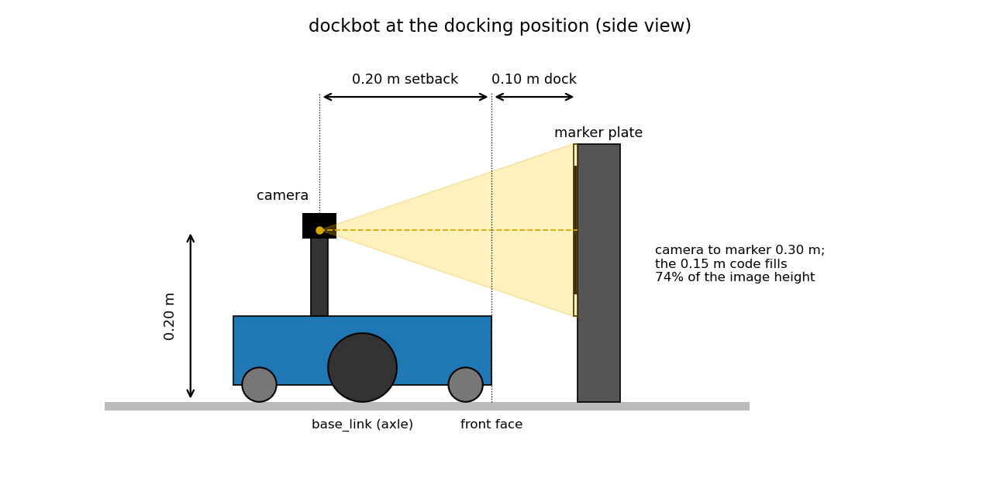
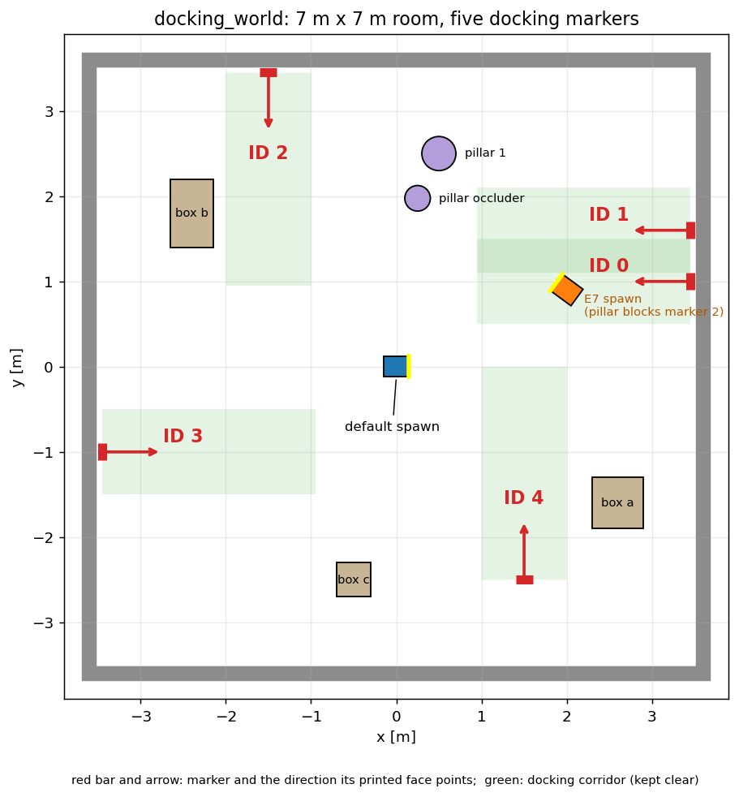
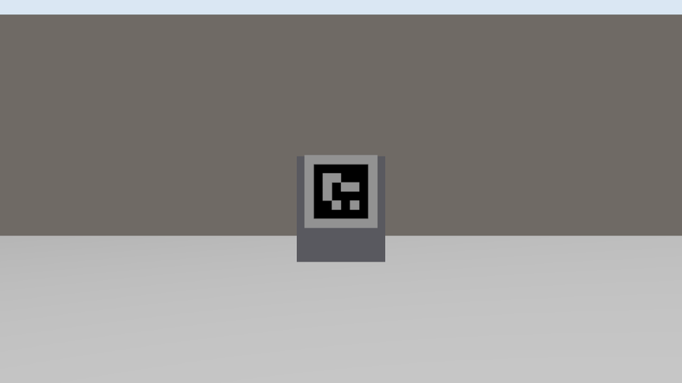

# ArUco_ROS_Nav

A ROS 2 Jazzy and Gazebo Harmonic simulation in which a differential-drive robot (`dockbot`) docks autonomously to a station identified by an ArUco marker, using only a camera-based pose estimate. There is no map, no external localisation, and no odometry in the control loop.

**Pipeline:** camera image → ArUco detector → marker pose relative to the robot → docking controller → `cmd_vel`. The robot stops with its front face 10 cm from the marker plane.

**Status:** the full pipeline works. In Gazebo the robot finds the marker it was asked for among five, drives to it and stops with its front face within 2 cm of the 10 cm target, from several start poses and with a second marker in view. The end-to-end suite (E1 to E12) passed in three consecutive full runs, the unit tests pass, and the Docker services were run on one machine. [docs/test_plan.md](docs/test_plan.md) lists what each run covered and which checks were not run (a clean `--no-cache` build, a second machine). Optional extras remain; see [docs/plan/README.md](docs/plan/README.md).

## What it looks like

<p align="center">
  
</p>

*`docking_world` in Gazebo: a 7 m x 7 m room with five docking markers (IDs 0 to 4), obstacles, and `dockbot` at its spawn point.*

| | |
|---|---|
|  |  |
| *`dockbot` facing markers 0 and 1, which sit side by side on purpose so the robot must pick the requested ID.* | *RViz: robot model, TF frames, odometry, and the live camera image (top left).* |

<p align="center">
  
</p>

The robot is a small differential-drive base with a camera on a mast, 0.20 m behind its front face, so the whole marker stays in view at the 10 cm docking distance:

<p align="center">
  
</p>

The world plan shows where each marker sits, which way its printed face points, and the corridor kept clear in front of it:

<p align="center">
  
</p>

What the robot's camera sees from 1.5 m in front of marker 4 (the detector reads this frame):

<p align="center">
  
</p>

## Packages

All nodes are C++17 with `rclcpp`; every package is `ament_cmake`. Python is used only for launch files, tests, and the marker image generator.

| Package | Contents |
|---|---|
| `dockbot_interfaces` | `ArucoMarker`, `ArucoMarkerArray`, `DockingState` messages and the `Dock` action |
| `dockbot_description` | Xacro model of `dockbot` with a mast-mounted camera, RViz config |
| `dockbot_gazebo` | Worlds, ArUco marker models (`DICT_4X4_50`, IDs 0 to 4), topic bridge, `sim.launch.py` |
| `dockbot_perception` | `aruco_detector` node: camera image → marker poses in `base_link` |
| `dockbot_docking` | `docking_controller` node: marker poses and a `/dock` goal → `/cmd_vel` |
| `dockbot_bringup` | `dock.launch.py`, test scenarios, end-to-end tests |

## Build and test

```bash
source /opt/ros/jazzy/setup.bash
colcon build --symlink-install
source install/setup.bash

# fast tests (no simulator)
colcon test --executor sequential --packages-select dockbot_perception dockbot_docking dockbot_gazebo dockbot_description
colcon test-result --verbose

# end-to-end tests E1 to E12 in headless Gazebo (about 20 minutes; one simulator per scenario)
colcon test --packages-select dockbot_bringup
```

Packages are tested one at a time (`--executor sequential`) because their node tests share one ROS domain and disturb each other when they run together; `dockbot_bringup` starts a full simulator, so always test it on its own. Required packages are listed in [docs/setup.md](docs/setup.md). Use the system OpenCV (4.6 on Ubuntu 24.04); do not install another copy.

## Run the demo

```bash
# terminal 1: Gazebo, the detector and the controller, with RViz
ros2 launch dockbot_bringup dock.launch.py world:=docking_world rviz:=true
# add gpu:=nvidia to render on an NVIDIA GPU, or headless:=true for no windows

# terminal 2: dock to marker 4, then to marker 0
ros2 action send_goal /dock dockbot_interfaces/action/Dock "{marker_id: 4}" --feedback
ros2 action send_goal /dock dockbot_interfaces/action/Dock "{marker_id: 0}" --feedback
```

Markers 0 and 1 sit side by side on purpose: the robot has to pick the one it was asked for. To start docking at launch without a second terminal, add `marker_id:=2`. The `/dock` result reports the outcome (`DOCKED`, `TARGET_NOT_FOUND`, `TARGET_LOST`, `RETRIES_EXCEEDED`, `TIMEOUT` or `CANCELED`) and the final gap, lateral offset and heading error. A goal can be cancelled at any time and the robot stops at once. `single_dock` is a smaller world with one marker, used for most of the end-to-end tests:

```bash
ros2 launch dockbot_bringup dock.launch.py world:=single_dock x:=1.0 marker_id:=0
```

The robot alone, in an empty world: `ros2 launch dockbot_gazebo sim.launch.py` (`headless:=true` for no GUI, `gpu:=nvidia|software` to pick the renderer).

## Docker

```bash
docker compose -f docker/compose.yaml run --rm test     # fast tests inside the container
docker compose -f docker/compose.yaml run --rm test-e2e # Gazebo end-to-end tests, headless
docker compose -f docker/compose.yaml run --rm dev      # development shell with the source mounted
./docker/run.sh                                         # GUI demo; picks the NVIDIA service when available
```

`WORLD` and `MARKER_ID` environment variables select the world and the marker to dock at. See [docs/setup.md](docs/setup.md#docker) for graphics options and the NVIDIA Container Toolkit.

## Key design points

- The 10 cm docking distance is measured from the robot's front face to the marker plane, not from `base_link` or the camera.
- The marker frame's z axis points out of the printed face; that is the docking normal.
- Marker poses come only from the camera. Ground truth is bridged for test scoring and never used for control.
- All nodes run with `use_sim_time:=true`.

## Documentation

Start with [docs/README.md](docs/README.md): architecture, interfaces, world and robot model, setup, test plan, and the milestone plan.

## Licence

Apache-2.0, see [LICENSE](LICENSE).
