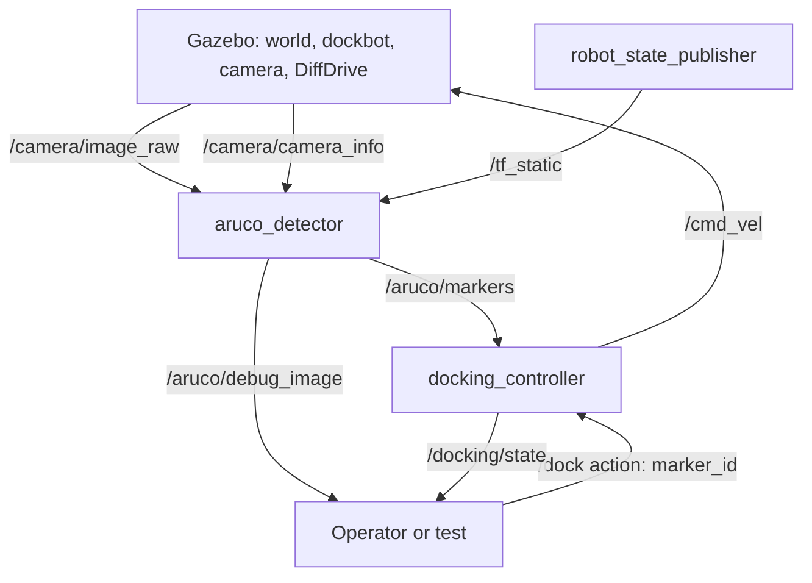
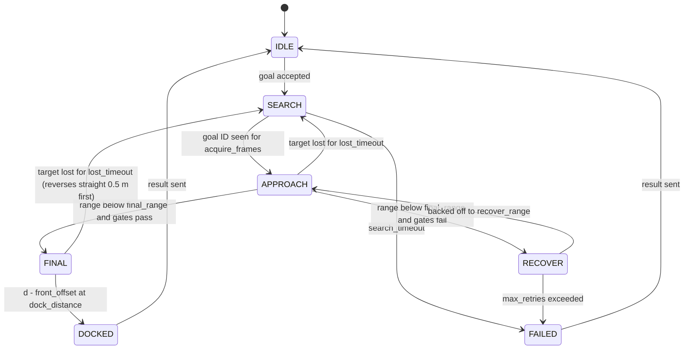
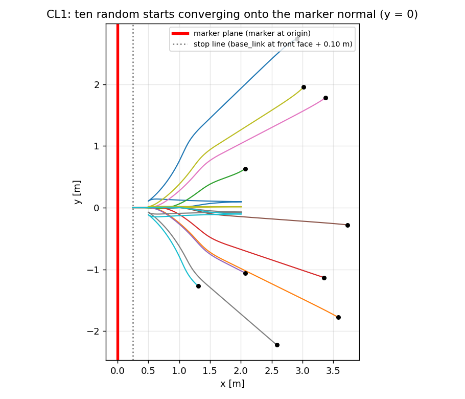

# Architecture

A differential-drive robot finds a docking station by its ArUco marker and parks 10 cm in front of it, using only its own camera. Nothing outside the robot tells it where it is.

## 1. Environment this design targets

These were checked on the development machine and shape several choices below.

| Item | Finding | Consequence |
|---|---|---|
| ROS and simulator | ROS 2 Jazzy on Ubuntu 24.04, Gazebo Harmonic (`gz sim` 8.15), `ros_gz_sim`, `ros_gz_bridge`, `ros_gz_image`, `xacro`, `robot_state_publisher`, `rviz2`, `colcon` | The core path needs no extra installs |
| OpenCV | 4.6.0 (`libopencv-dev`, `libopencv-contrib-dev`). Only the legacy ArUco API exists (`cv::aruco::detectMarkers`, `drawMarker`); `cv::aruco::ArucoDetector` does not. `SOLVEPNP_IPPE_SQUARE` is available | The detector wraps both API generations behind one function, selected at compile time, and estimates pose with `solvePnPGeneric` rather than `estimatePoseSingleMarkers`, which newer OpenCV removed |
| C++ toolchain | g++ 13.3, CMake 3.28, Eigen 3.4, `rclcpp`, `rclcpp_action`, `rclcpp_components`, `cv_bridge`, `tf2_eigen`, `ament_cmake_gtest`, and the `ament_cmake` linters | Nodes can be built in C++ with nothing further to install |
| Graphics | Intel UHD (Mesa) and an entry-level NVIDIA GeForce with 2 GB, in on-demand mode: programs render on Intel unless told to use NVIDIA. Both provide OpenGL 4.6 | Either GPU can run the simulator. The camera is modelled on an IMX219 at 1280x720 and 30 Hz, which is a real load for an entry-level card. M1 measures both GPUs and picks the default; the camera rate is a launch argument if neither holds 30 Hz. See [setup.md](setup.md) |
| Not installed | `gz_ros2_control`, `launch_pytest` | Drive uses the Gazebo `DiffDrive` system plugin. Integration tests use `launch_testing` |

Installed TurtleBot3 packages are a useful reference, not a dependency:

- `/opt/ros/jazzy/share/turtlebot3_gazebo/launch/turtlebot3_world.launch.py` and `spawn_turtlebot3.launch.py` show the launch pattern to copy: `gz_sim.launch.py` for server and GUI, `ros_gz_sim create` to spawn, `parameter_bridge` driven by a YAML file, `image_bridge` for the camera.
- `/opt/ros/jazzy/share/turtlebot3_gazebo/params/turtlebot3_waffle_pi_bridge.yaml` is the template for the bridge configuration.
- `turtlebot3_aruco_tracker` shows the detection flow, but hard-codes the camera frame rotation and marker size.

## 2. Design decisions

| # | Decision | Reason |
|---|---|---|
| D1 | Custom robot `dockbot` instead of TurtleBot3 | The brief asks for a camera on top. Stopping 10 cm from the marker also requires the camera to sit well behind the front face, or the marker no longer fits in the image. TurtleBot3 waffle_pi has its camera 9 cm high at the nose. A small Xacro gives control over that geometry |
| D2 | All nodes in C++17 with `rclcpp` | Project requirement. Launch files, the end-to-end test harness, and the marker image generator stay in Python, since none of them is a node |
| D3 | The 10 cm is measured from the robot's front face to the marker plane, along the marker normal | "Distance to the marker" is ambiguous. This definition matches what a physical dock needs and is directly measurable in simulation |
| D4 | The target marker is chosen through an action, `/dock`, whose goal carries the marker ID | Makes "dock to the correct marker" an explicit, testable request, with feedback, a result, and cancellation |
| D5 | The control law uses only the marker pose relative to the robot | The brief rules out external localization. There is no map, no AMCL, and no odometry in the control loop |
| D6 | Obstacles are static clutter and occluders. Obstacle avoidance is outside the core scope | A camera-only robot cannot sense them. Test scenarios keep a drivable corridor. A lidar safety stop is a stretch item (M7) |
| D7 | `cmd_vel` is `geometry_msgs/TwistStamped` | Matches the Jazzy convention used by the TurtleBot3 bridge and Nav2 |
| D8 | Gazebo ground truth is bridged for tests only | Tests need the true final pose to score a dock. No runtime node subscribes to it |
| D9 | A Docker image is a supported way to build, test, and run the project | It must run on machines other than the development one. The image installs dependencies through `rosdep` from the package manifests, so it also proves the manifests are complete |

## 3. Packages

The repository root is the colcon workspace. All packages live in `src/`.

Every package is `ament_cmake`.

| Package | Contents |
|---|---|
| `dockbot_interfaces` | `ArucoMarker.msg`, `ArucoMarkerArray.msg`, `DockingState.msg`, `Dock.action` |
| `dockbot_description` | `urdf/dockbot.urdf.xacro`, RViz configuration |
| `dockbot_gazebo` | Worlds, ArUco marker models and their generator script, bridge YAML, simulation launch files |
| `dockbot_perception` | Library `pose_estimation` (ROS-free: OpenCV and Eigen only); node `aruco_detector` |
| `dockbot_docking` | Libraries `control_law` and `state_machine` (ROS-free: Eigen only); node `docking_controller` |
| `dockbot_bringup` | Top-level launch files, scenario configurations, end-to-end tests |

Source layout in the two node packages follows the usual C++ pattern: headers in `include/<package>/`, sources in `src/`, tests in `test/`.

Each node is a class registered as an `rclcpp` component and is also built as a standalone executable. The launch files start the executables; loading both components into one container, to pass images without copying, remains possible later without code changes.

Keeping the maths in ROS-free libraries is deliberate: most of the test suite then runs as plain `gtest` binaries, without ROS or a simulator.

Python is used only where no node is involved: launch files, the end-to-end test harness and its scoring helper, small static tests that parse the Xacro and SDF files, and the script that generates marker images.

## 4. Data flow

One sentence version: camera image, to ArUco detection, to marker pose relative to the robot, to the docking controller, to velocity commands.

## 5. Coordinate frames

| Frame | Definition |
|---|---|
| `base_footprint` | On the ground, midway between the drive wheels |
| `base_link` | At the wheel axle centre. x forward, y left, z up (REP 103) |
| `camera_link` | Camera body. x forward |
| `camera_optical_frame` | OpenCV convention: z forward, x right, y down. The Gazebo sensor stamps images with this frame |
| `aruco_<id>` | Marker frame, origin at the marker centre. x to the marker's right, y up, **z out of the printed face toward the viewer** |
| `odom` | Published by the DiffDrive plugin. Present for RViz; unused by the controller |

The marker's z axis is the **docking normal**. A docked robot sits on that line, facing against it.

The detector never hard-codes the rotation between the optical frame and `base_link`. It looks the transform up from TF once, from the frame named in the image header, and caches it.

## 6. `aruco_detector`

Processing per image:

1. Convert to greyscale.
2. Detect markers of the configured dictionary. A small wrapper hides the OpenCV version difference: a compile-time check on `CV_VERSION` uses `cv::aruco::ArucoDetector` on 4.7 and later, and the free function `cv::aruco::detectMarkers` on 4.6.
3. For each marker, solve for pose with `cv::solvePnPGeneric(..., cv::SOLVEPNP_IPPE_SQUARE)`, which returns both planar solutions. Keep the one with the lower reprojection error. Drop the marker if that error exceeds `max_reprojection_error`.
4. Transform the pose from `camera_optical_frame` into `base_link`.
5. Compute `range` (ground-plane distance to the marker centre) and `bearing` (angle to it, positive to the left).
6. Publish one `ArucoMarkerArray` per image, stamped with the image time. An image with no markers still produces an empty array, so consumers can tell "nothing seen" from "detector stalled".
7. Optionally broadcast `base_link -> aruco_<id>` on TF and publish an annotated debug image.

The detector reports every marker it sees. Choosing which one matters is the controller's job.

## 7. `docking_controller`

### 7.1 Error terms

All are computed from the goal marker's pose in `base_link`. Let `p` be the marker position on the ground plane and `n` the unit marker normal projected onto the ground plane.

| Symbol | Meaning |
|---|---|
| `d` | Distance from the marker plane to `base_link`, along the normal |
| `e_y` | Sideways offset of the robot from the normal line |
| `psi` | Heading error: angle between the robot's forward axis and the inward normal. Zero when the robot faces the marker squarely |
| `bearing` | Angle from the robot's forward axis to the marker centre |

Docking is complete when `d - front_offset <= dock_distance`, with `e_y` and `psi` near zero.

### 7.2 State machine

Cancellation and `dock_timeout` lead to `FAILED` from any active state. Every path out of an active state publishes a zero velocity first.

### 7.3 Behaviour in each state

**SEARCH.** Rotate in place at `search_angular_speed`. Leave when the goal ID has appeared in `acquire_frames` consecutive detections. Markers with any other ID are ignored completely: they never change state and never influence a command. When re-entering after losing the target, turn toward the side where it was last seen.

**APPROACH.** The robot has to end up on the normal line, facing the marker, while never turning so far that the marker leaves the camera's view. The law used is a carrot pursuit along the normal with a field-of-view clamp:

1. Place an aim point on the normal line, a fraction of the remaining distance in front of the marker: `aim = p + aim_gain * d * n`.
2. The desired heading is the direction to that aim point.
3. Clamp the desired heading to within `max_bearing_offset` of the marker bearing. With a 31 degree half field of view and a 25 degree clamp, the marker centre stays 6 degrees inside the frame edge. Test CL6 checks that this is enough.
4. Turn rate is proportional to the desired heading (`turn_gain`). Forward speed is `v_final + speed_gain * (range - final_range)` capped at `v_max`, scaled by the squared cosine of the desired heading and reduced again as the marker bearing nears the edge of the view, so the robot turns first and drives second and the turn can keep up with the bearing.

The clamp in step 3 is what limits how fast the robot can join the normal line: with the marker kept within 25 degrees of the heading, the angle off the normal shrinks by at most `tan(25 deg) * ln(r0 / r1)` while the range falls from `r0` to `r1`. A start 50 degrees off the normal at 2 m cannot be aligned by `final_range`, which is why RECOVER is part of normal operation and not only an error path (about half of the CL1 starts use it).

As `d` shrinks, the aim point slides toward the marker, so the path bends onto the normal line and the robot arrives already aligned.

Beyond `yaw_trust_range` the marker's orientation estimate is unreliable, because a small square seen from far away gives a noisy, sometimes flipped, tilt. There the controller ignores `n` and simply drives toward the marker by bearing. The alignment behaviour takes over once inside that range.

**FINAL.** Entered when the range to the marker centre drops below `final_range` (not `d`, so a robot still far to the side keeps approaching and wastes no retry) and both `|e_y| <= gate_lateral` and `|psi| <= gate_heading`. The robot creeps forward at `v_final` with small proportional corrections on `psi` and `e_y`, slowing to 40% of `v_final` over the last `v_final / final_slow_gain` metres so that detection lag or a short dropout cannot carry it far past the stop point, and stops when `d - front_offset <= dock_distance`.

**RECOVER.** Entered when the robot reaches `final_range` misaligned, or when FINAL drifts past twice the gate limits. It reverses to `recover_range` (2 m) holding the marker off-centre, on the side of the normal line the robot is on, by up to 0.9 of `max_bearing_offset`. Backing away this way swings the line of sight toward the normal, so the next approach starts better aligned. It then returns to APPROACH. After `max_retries` attempts the goal fails.

**Marker lost in FINAL.** After `lost_timeout` the robot reverses straight at the reverse speed for 0.5 m before it starts turning in place, because it is only centimetres from the dock. A reacquire during the back-off goes back to APPROACH as usual.

**DOCKED / FAILED.** Publish zero velocity, send the action result with the final measured errors, return to IDLE.

Ten CL1 trajectories from the kinematic simulator (dots are the starts, the marker is at x = 0, normal along +x). Paths that first run out to x = 2 m are RECOVER backing away before a second approach:

### 7.4 Handling imperfect input

- **Short dropouts.** For up to `lost_hold_time` after the last detection, keep the last command, decaying toward zero. After that, stop. After `lost_timeout`, return to SEARCH.
- **Filtering.** Marker position is exponentially smoothed (`pose_filter_alpha`). The filter resets on every SEARCH to APPROACH transition.
- **Stale or invalid data.** A pose older than `pose_stale_time`, or containing NaN, is treated as no detection.
- **Limits.** Linear and angular velocity and acceleration are clamped on every cycle.

### 7.5 What the controller deliberately does not use

Odometry, lidar, a map, or the Gazebo ground truth. Using wheel odometry to bridge longer detection gaps would be legitimate, since it is onboard, but it is left as a stretch item so the core result demonstrably rests on the camera alone.

## 8. Launch structure

| Launch file | Package | Starts |
|---|---|---|
| `sim.launch.py` | `dockbot_gazebo` | Gazebo with a chosen world, the robot, `robot_state_publisher`, the bridges. Arguments: `world`, `x`, `y`, `yaw`, `headless`, `gpu` (`auto`, `intel`, `nvidia`, or `software`; default `auto`) |
| `dock.launch.py` | `dockbot_bringup` | `sim.launch.py` plus `aruco_detector`, `docking_controller`, and optionally RViz. Arguments add `marker_id` and `rviz` |

All nodes run with `use_sim_time:=true`, and every timeout in the controller is measured on the node clock, so behaviour does not depend on how fast the simulator runs.

## 9. Running in Docker

The repository carries one multi-stage `docker/Dockerfile` and a `docker/compose.yaml`. Full detail is in [plan/M8_docker.md](plan/M8_docker.md).

- **Stages.** `base` (the official `ros:jazzy-ros-base` image plus everything `rosdep` resolves from the manifests), `dev` (tools and a non-root user, source mounted from the host), and `runtime` (source copied in and built).
- **Services.** `test` and `test-e2e` run the suites headless; `sim` and `sim-nvidia` run the demo with windows on the host display; `dev` gives a shell.
- **One container runs the whole system.** The simulator, bridges, both nodes, and RViz share it, so nothing depends on ROS discovery between containers.
- **Graphics.** The `gpu` launch argument takes `auto` (the default: NVIDIA when a working NVIDIA driver is found, otherwise `intel`), `intel`, `nvidia`, or `software`. Software rendering works anywhere, including CI, at the cost of speed. Because all controller and test timing uses simulation time, a slow renderer changes how long a run takes, not whether it passes.

Nothing in the nodes or launch files may depend on the host: no absolute paths, no assumptions about a home directory, resources located through `ament_index`.

## 10. Known limits

- The GUI demo in Docker is supported on Linux and on Windows through WSL 2. On macOS only the tests run, since Docker there has no GPU access.

- Reliable detection range is about 6 m with the chosen camera and marker (see [world_and_robot.md](world_and_robot.md)). Every marker in the world is within 3.8 m of the default spawn point, well inside that range.
- The robot does not avoid obstacles. A marker reachable only by driving around something is out of scope until M7. Under a partial occlusion it can drive close to an obstacle while it searches and approaches again (see test E7 in [world_and_robot.md](world_and_robot.md)).
- If the goal marker is not visible from where the robot stands after a full search rotation, the goal fails. The robot does not explore.

## 11. Licence

The project is released under the Apache License 2.0 (`LICENSE` at the repository root). Every `package.xml` declares `Apache-2.0`, and every source, CMake, and Python file begins with the Apache-2.0 copyright header, which `ament_copyright` checks as part of the lint tests (S2).
