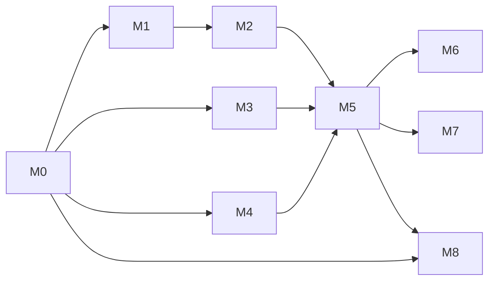

# Master plan

How the ArUco docking simulation gets built: nine milestones, each with its own plan file, sub-task checklist, and test gate. Design background is in [../architecture.md](../architecture.md); test IDs refer to [../test_plan.md](../test_plan.md).

## Milestones

| # | Milestone | Delivers | Gate | Plan |
|---|---|---|---|---|
| M0 | Workspace and interfaces | Colcon workspace, six package skeletons, messages and action, lint setup | S1, S2 | [M0](M0_workspace_interfaces.md) |
| M1 | Robot | `dockbot` Xacro, camera, drive, bridges, an empty-world launch | S3, MAN3, headless camera check | [M1](M1_robot.md) |
| M2 | World and markers | Marker models for IDs 0 to 4, both worlds, `markers.yaml` | S3, S4, every marker readable | [M2](M2_world_markers.md) |
| M3 | Perception | `aruco_detector` node and its maths module | P1 to P8, PN1 to PN4, E10 | [M3](M3_perception.md) |
| M4 | Docking controller | `docking_controller` node, control law, state machine, kinematic test simulator | C1 to C9, CL1 to CL6 | [M4](M4_docking.md) |
| M5 | Integration and validation | Full launch, scenarios, ground-truth scoring, end-to-end suite | E1 to E12 | [M5](M5_integration.md) |
| M6 | Documentation and demo | README quick start, final docs, commands in the README | MAN1, MAN2 | [M6](M6_docs_demo.md) |
| M7 | Stretch | Lidar safety stop, odometry bridging, multi-dock sequencing | Optional | [M7](M7_stretch.md) |
| M8 | Docker | Multi-stage image, Compose services for tests and the demo, helper script, optional CI | DK1 to DK9 | [M8](M8_docker.md) |

M8 is required, not a stretch item. It is numbered last because it was added last.

## Order and dependencies

M3 and M4 depend only on the interfaces from M0. Their unit and closed-loop tests need no simulator, so both can proceed alongside M1 and M2. The one exception is test E10 in M3, which needs the world from M2.

M8 starts as soon as M0 builds: the first image only needs a workspace that compiles. From then on each milestone is checked in the container as well as on the host, which catches undeclared dependencies early. M8 finishes after M5, once the end-to-end tests exist to run inside the image.

Suggested order for one person: M0, M8 (first image), M1, M2, M3, M4, M5, M8 (finish), M6.

## Requirement traceability

Each requirement in the brief, where it is built, and what proves it.

| Requirement from the brief | Built in | Proven by |
|---|---|---|
| Gazebo world with obstacles and ArUco markers at docking locations | M2 | S3, S4, M2 exit check |
| Differential-drive robot with a camera on top | M1 | S3, MAN3 |
| Node that detects ArUco markers from the camera | M3 | P1 to P5, P7, PN1 |
| Node publishes marker pose relative to the robot | M3 | P6, P8, PN1, PN4, E10 |
| Docking node subscribes to the marker pose and computes velocity commands | M4 | C1 to C9, CL1 |
| Robot approaches and aligns with the marker | M4, M5 | CL1, CL4, E1, E2 |
| Robot stops within a set distance (10 cm) | M4, M5 | C2, E1, E9 |
| Multiple markers at different locations; robot picks the correct one | M2, M5 | C6, E4, E5, E6 |
| Docks precisely | M5 | E1 to E5, E9 |
| No external localization | M4 | Design decision D5; controller subscribes only to `/aruco/markers` |
| Runs on ROS 2 Jazzy with Gazebo and RViz | M1, M6 | MAN1, MAN2 |
| Runs on other systems (added requirement) | M8 | DK1 to DK4, DK8 |

## Definition of done

For any milestone:

- Every sub-task in its plan file is checked off.
- Its gate tests pass, and earlier gates still pass.
- Every new function has a comment saying what it does and how it serves docking (project convention). The linters do not check this, so it is part of review.
- The affected documents under `docs/` match the code, including parameter defaults in [../interfaces.md](../interfaces.md).

For the project: all of M0 to M6 and M8 done, and E1 to E12 pass three runs in a row, on the host and in the container.

## Risks

| Risk | Likelihood | Effect | Response |
|---|---|---|---|
| Headless camera rendering fails (checked in M1: works, 30 Hz, real-time factor 1.0) | Low | End-to-end tests cannot run unattended | Two GPUs are available (Intel and NVIDIA), and either may work where the other does not. Check both in M1. Fallback: run the E suite with the GUI, or under `xvfb` |
| A kernel update breaks the NVIDIA driver | Medium | Simulator falls back to Intel, or fails to start if `gpu:=nvidia` is the default | Keep the driver on a supported branch. The `gpu:=intel` and `gpu:=software` paths always remain |
| Simulator graphics do not work in a container on someone else's machine | Medium | The demo cannot be shown there, though tests still run | Separate Compose services per graphics case, software rendering as the universal fallback, and a helper script that picks one (M8) |
| End-to-end tests too slow under software rendering | Medium | Container and CI runs time out | Time limits in simulation time; a lower camera rate for CI through a launch argument |
| A second OpenCV gets installed (pip or source build) | Low | Crashes or link errors in the detector | Stay on the system OpenCV 4.6; see [../setup.md](../setup.md) |
| Marker texture mapped mirrored or rotated in SDF | Medium | No detections at all | M2 exit check reads every ID through the simulated camera |
| Marker orientation estimate is noisy or flipped at long range | High | Robot steers the wrong way early in the approach | Orientation ignored beyond `yaw_trust_range`; both planar solutions compared (P8, C8) |
| Detection unreliable at long range | Low | SEARCH misses far markers | Reliable range is about 6 m and the room keeps markers within 3.8 m. Fallback: raise camera resolution or marker size |
| 1280x720 at 30 Hz is too heavy for the GPU | Medium | Real-time factor drops, the camera rate falls below 30 Hz | Measured on both GPUs in M1. Fallback: lower `camera_rate`; controller timing uses simulation time, so behaviour is unchanged |
| Marker leaves the field of view during approach | Medium | Approach stalls or oscillates between SEARCH and APPROACH | Field-of-view clamp in the control law (C4, CL6) |
| Simulation runs slower than real time | Medium | Timeouts fire early, tests flake | All timing on simulation clock |
| Wheel slip or caster drag makes the final creep uneven | Low | Overshoot past 10 cm | Low `v_final`, acceleration limits, tolerance of 2 cm |

## Working conventions

- One branch per milestone; commit when a sub-task's tests pass.
- Tune parameters in the YAML files, never in code, and record the final values in [../interfaces.md](../interfaces.md).
- When a design decision changes, update the decision table in [../architecture.md](../architecture.md) in the same commit.
